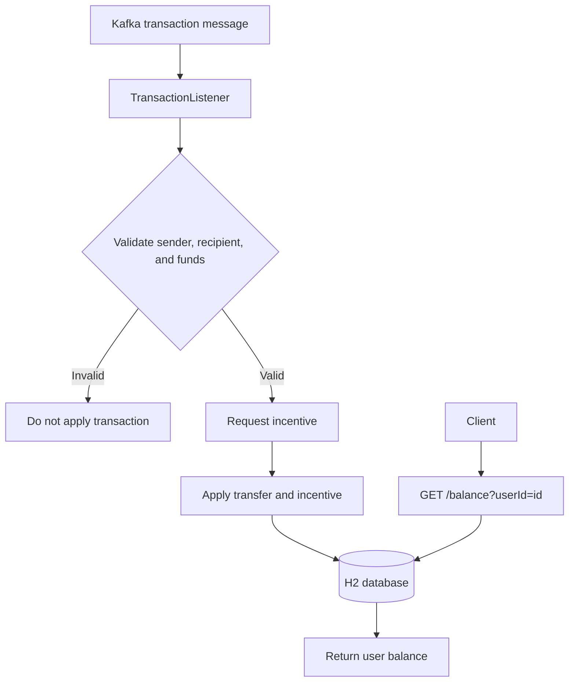

<div align="center">

# Midas Core

### Event-driven transaction processing with Java, Spring Boot, and Apache Kafka

Built as part of the **Forage JPMorgan Chase & Co. Software Engineering Job Simulation**.


</div>

> **Disclaimer:** This is an educational project completed through the Forage JPMorgan Chase & Co. Software Engineering Job Simulation. It is not a JPMorgan Chase production system and does not represent employment or an internship at the company.

---

## Overview

**Midas Core** is a Java and Spring Boot transaction-processing service that consumes transaction messages from Apache Kafka, validates transfers, applies eligible transactions, persists transaction data, and exposes an HTTP endpoint for balance lookups.

The project demonstrates core backend engineering concepts including event-driven messaging, REST APIs, data persistence, transaction validation, and integration testing.

## Key features

- **Kafka-based processing:** Consumes transaction messages from the `midas-core-topic` topic.
- **Transaction validation:** Checks that sender and recipient accounts exist and that the sender has enough funds.
- **Incentive integration:** Requests an incentive from an external service and credits the returned incentive to the recipient.
- **Data persistence:** Uses Spring Data JPA with an in-memory H2 database for user and transaction records.
- **Balance API:** Exposes an endpoint to retrieve a user's balance.
- **Integration testing:** Includes task verifiers and Kafka-related test infrastructure.

## Transaction flow



Transactions are applied only when the sender and recipient exist and the sender can cover the transfer amount. The recipient receives the transfer amount plus the incentive returned by the incentive service.

The incentive service is expected at:

```text
http://localhost:8080/incentive
```

## Technology stack

| Area | Technology | Purpose |
|---|---|---|
| Language | Java 17 | Core application logic |
| Framework | Spring Boot 3.2.5 | Application and REST service |
| Messaging | Apache Kafka, Spring Kafka | Event-driven transaction consumption |
| Persistence | Spring Data JPA, H2 | Entity persistence and in-memory database |
| Testing | JUnit 5, Spring Boot Test, Embedded Kafka | Automated and integration testing |
| Build | Maven Wrapper | Consistent Maven commands |

## Getting started

### Prerequisites

- JDK 17
- A Kafka broker accessible at `localhost:9092`
- The incentive service accessible at `localhost:8080` for processing transactions
- A terminal such as PowerShell, Command Prompt, or a Unix shell

The application listens on port **33400**. The H2 database is in memory, so stored data resets when the application stops.

### 1. Clone the repository

Replace `<repository-url>` with the URL of your GitHub repository.

```bash
git clone <repository-url>
cd midas-core
```

### 2. Start the application

On Windows PowerShell, run the Maven Wrapper from the repository root:

```powershell
.\mvnw.cmd spring-boot:run
```

If your repository's wrapper is named or located differently, use the wrapper path present in your checkout.

### 3. Check a user's balance

Use a user ID to query the balance endpoint:

```powershell
Invoke-RestMethod "http://localhost:33400/balance?userId=1"
```

Or open the endpoint in a browser:

```text
http://localhost:33400/balance?userId=1
```

The endpoint returns the balance for the requested user. If no user exists with that ID, the current implementation returns a balance of `0`.

> **Note:** A successful balance lookup does not by itself verify Kafka transaction processing. To process transactions, ensure Kafka and the incentive service are available and configured as expected by the application.

## Running tests

The repository includes task-specific Forage verifiers. Run an individual verifier with the Maven Wrapper, for example:

```powershell
.\mvnw.cmd -Dtest=TaskOneTests test
```

Other task verifier classes include `TaskTwoTests`, `TaskThreeTests`, and `TaskFourTests`.

**Test execution note:** According to the project setup, some task verifiers are intended for manual inspection and may continue running. Stop those test runs after capturing the required result. Kafka-backed tests use embedded Kafka, and transaction processing may also call the incentive service at `localhost:8080`.

## Project structure

```text
src/
├── main/
│   └── java/com/jpmc/midascore/
│       ├── component/    # Balance endpoint, Kafka listener, transaction processing
│       ├── entity/       # JPA user and transaction records
│       ├── foundation/   # Transaction, balance, and incentive models
│       └── repository/   # Spring Data repositories
└── test/
    ├── java/             # Forage task verifiers and test helpers
    └── resources/        # Transaction and user fixtures
```

## What I learned

- Building event-driven services with Apache Kafka and Spring Kafka
- Implementing REST endpoints with Spring Boot
- Validating transaction data and applying business rules
- Persisting application data with Spring Data JPA
- Working with an in-memory H2 database
- Running task-based tests and integration tests in a Java backend project

## Certificate

**Forage — JPMorgan Chase & Co. Software Engineering Job Simulation**  
**Completion date:** December 20, 2025

```markdown

```

## License

No `LICENSE` file is currently specified in this repository. Unless a license is added, the project does not explicitly grant permission to reuse, modify, or redistribute the code.
